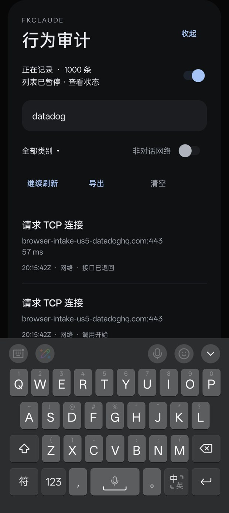
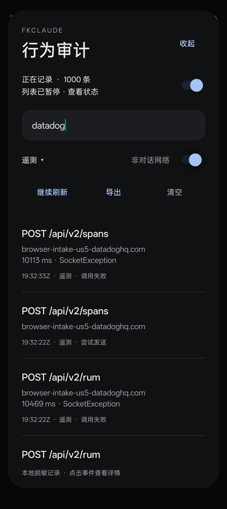

# fkclaude

为 Claude Android 提供可配置的进程环境视图与本地行为审计的 LSPosed 模块。当前适配 `com.anthropic.claude` **1.261112.18 / 26111218**。普通配置在其他版本跳过定向环境覆盖；仅美国策略遇到目标版本不匹配会停止目标进程。IP 守卫使用独立的通用接口。

当前源码版本 **0.4.4 / versionCode 9**，95 个配置项。支持设备 ID 持久随机化、Android ID、设备与系统字段、语言时区、运营商、局域网、屏幕电池、内存存储，以及部分隐私 API 的拦截和自定义。重点覆盖已定位的 **Sift 环境采集、事件队列与上传链路**。不修改 Claude 原始安装包或原始设备 ID 偏好。

新增 arm64 原生接口覆盖、虚拟 `getprop`／`mount` 查询和 WebView 页面开始执行前的脚本覆盖。Build、系统属性和查询输出共用配置映射；原生层和网页可读取同一组 CPU／容量／语言时区配置。WebView 可选择阻断 Canvas、WebGL、音频和设备枚举，可能影响图表或语音，0.3.0 预设默认关闭该项。常规预设沿用系统语言／时区，局域网地址用不可用语义；重复应用预设保留已有设备 ID 和 IP 守卫配置。显式选择“美国隐私配置”后，Claude 进程内的地区字段采用 en-US、America/New_York 和美国国家代码，本机定位保持不可用，网络须通过美国探测与明确白名单。

这不是完整 Android 沙箱：直接系统调用、procfs、Worker、公网 IP 和硬件证明仍有边界。默认预设会阻断 Sift 等部分采集，其他字段仍可按需覆盖；详见覆盖清单。

## 使用

1. 构建：`./gradlew :app:assembleDebug`。产物为 `app/build/outputs/apk/debug/app-debug.apk`，为调试签名构建。
2. 安装模块，在 LSPosed 中启用并仅选择 Claude。
3. 打开模块设置，选择各项沿用、拦截或自定义，点击保存。
4. 完全重启 Claude 后生效。更换设备 ID 也需要保存并重启；配置不会每次请求随机变化。

普通配置可关闭总开关或停用模块，再完全重启 Claude，恢复原有数据来源。仅美国策略会强制保留其必需保护；调整这些保护前须明确关闭该策略。修改 API 级别、屏幕和容量等值可能影响兼容性或 UI。

模块没有联网权限；私有配置 Provider 仅接受模块和 Claude 的 UID。配置使用私有、原子保存的权威快照，旧 legacy 值不抢占已保存策略；目标进程无法取得 Provider 时可读取 LSPosed API 93+ 的框架共享配置。编辑与发布要求框架桥接可靠可用，桥接不可用时暂停编辑或报告发布失败。配置损坏、读取或初始化失败会停止目标进程，避免回退到较弱配置。快照不存账号或令牌，编码不附带本地日期与时区注释；SHA-256 用于检出损坏，不能抵抗同 UID 的恶意篡改。普通配置遇到版本不匹配时跳过定向环境覆盖，IP 守卫仍独立工作；仅美国策略在目标版本不匹配时停止目标进程。日志不记录实际 ID／令牌。

构建需要 Android SDK 36、NDK 27.1.12297006、CMake 3.22.1 和 JDK 21；当前原生制品只包含 `arm64-v8a`。旧配置升级时保留已有字段，新原生／查询／WebView 总开关缺省启用；新增 Canvas 等阻断开关缺省关闭，应用隐私预设才会开启。

## 实时行为审计

打开设置中的“打开 Claude 行为审计”，或点 Claude 内可拖动的“审计”入口。弹窗支持中文实时事件列表、搜索、分类、非对话网络筛选、完整 JSON 查看、记录开关、暂停刷新、关闭重开、清空确认与系统文件选择器导出。日志行保留请求方法、路径、主机、状态和耗时；JSONL／NDJSON 便于脚本和 AI 继续分析。

**“非对话网络”开关只筛选审计列表显示，不改变网络准入。** 实际阻断由严格策略强制的 Sift 采集／队列／派发拦截、预置及用户配置的遥测域名规则，以及 IP 守卫共同执行。审计记录目的地、路径、结果和可观察字节统计，不读取完整 TLS 正文，无法据此证明所有敏感负载已识别，也不保证账号不会被封禁。同域 API 遥测、直接系统调用、未知 SDK／版本和账户历史仍有边界；恢复联网前须验证受信美国出口与必要请求链路。当前空名单保持阻断，报告只保留脱敏汇总。

审计独立于环境覆盖开关，观察隐私 API、Sift／产品分析、HTTP、WebView 和原生 socket。记录只包含经过限制的元数据，正文、令牌、Cookie 和设备 ID 原值不入日志；原生层保留远端目的 IP，便于追踪未知流量，不记录本机源 IP 或数据缓冲区。私有日志排除 Android 自动备份，容量有界，丢弃和错误可见。

详见[使用与日志说明](docs/audit-logging.md)和[既有静态隐私证据](docs/privacy-analysis-2026-11-17.md)。开发机可用 `python3 scripts/audit_logs.py <JSONL或NDJSON文件或目录> --json` 生成汇总。

## IP 守卫

在“IP 白名单守卫”中开启独立开关，填入允许的公网 IP／CIDR，保存并完全重启 Claude。IPv4 与 IPv6 传输分别取得短期许可；名单为空、回显失败、不匹配、许可过期或网络变化时阻断连接并关闭连接池中的 Internet socket。默认关闭，**不自动信任当前出口，也不预填白名单**。

探测从 Claude 进程匿名发起 HTTPS 请求，使用独立 TLS 上下文，不复制账号头、Cookie 或客户端密钥。默认直连／VPN/TUN 路由受支持；显式 HTTP/SOCKS 客户端代理拒绝放行。每次探测有时效检查，原生许可最长 10 秒；这是进程内守卫，不能保证零延迟检测或替代系统 UID 防火墙。分域代理、其他 UID 代发及直接系统调用仍有边界。详见 [IP 守卫说明](docs/ip-guard.md)。

## 0.4.4 美国隐私策略与验证

新增显式“美国隐私配置”：拒绝已覆盖的本机位置与附近信息入口、统一 Claude 进程内的地区字段，并强制启用网络守卫。策略在配置解析、预设和保存时统一约束；重复应用普通预设保留已经开启的严格策略，已有虚拟身份、白名单和无关自定义保护保持。

严格模式使用独立 Cloudflare 探测端点，要求唯一有效的 `loc=US`、明确 IP／CIDR 白名单、同一地址族和有效许可同时满足。美国机房的 `colo` 不参与国家判定。空白名单保持离线且不发起探测，不会自动信任当前出口；配置不会代为设置 VPN。

发布前复核修复了配置回退和旧界面保存可能削弱策略的路径：原子权威快照优先于 legacy 配置，基线比较拒绝旧 Activity 覆盖新策略；损坏或发布失败明确报错。配置文本移除了自动添加的本地日期／时区注释。原生守卫同时成为 7 个观察入口的唯一 hook 安装方，修复 write／writev 的重复安装，审计暂停仍保留网络防护。

最终源码为 [736b234](https://github.com/LIghtJUNction/fkclaude/commit/736b234b3f1433bcde2926c6cb3bcb1f46a08999)，APK 为 **4,466,009 字节**，SHA-256：`76f51a58d10383ba2b9507a3545bbf4c9f60c798f6302345d65f9267816b2446`。本轮 **132/132 Java、22/22 Node** 通过；配置可靠性 24 项和网络定向 25 项已包含在 Java 总数中。原生真实回环 socket 包装层回归经过 ASan／UBSan；Lint 为 **0 错误、10 个既有警告**，DEX、16 KiB 对齐与 v2 签名检查通过。Python CLI 本轮未重跑。

最终 APK 已安装，安装端 SHA-256 与构建一致；两次冷启动均从框架读取美国策略，15/15 诊断回读符合预期，空名单阻断且没有初始化失败。原生审计两次均为 **7/7 安装成功、0 失败**。稳定窗口包含 971 条有效事件：DNS 47 次和 HTTP 33 次全部失败、原生连接阻断 6 次，应用正字节观察与探测事件均为 0；这些是审计覆盖路径的结果，本轮未做系统全流量抓包。

真机临时损坏权威快照后，模块只提供“暂停编辑／重新读取”，保存与预设操作不可用；恢复原文件、核对内容与权限后，重新读取和保存成功，严格策略、空名单和原虚拟身份保持。注入期间 Claude 始终停止。原审计历史 1 个文件已恢复且内容指纹一致，测试与故障备份、私有哈希、录屏、辅助资源和虚拟显示已清理；Claude 已停止，严格配置和定位拒绝保留，ADB 服务保留。

**当前没有已验证的美国出口，IP 白名单仍为空，策略要求 Claude 离线。** 系统 always-on VPN 和非 VPN 阻断未配置；在线放行、真实出口切换和 VPN 掉线场景未验收。补修前的 partial 观察状态与最终 7/7 结果分开记录。详见[位置隐私分析与设备证据](docs/location-privacy-2026-11-20.md)和[0.4.4 发布摘要](docs/releases/0.4.4.json)。

## 0.4.3 更新与验证（历史）

本轮修复了日志断写后的续写边界，并把导出内容改为一次捕获的不可变快照。历史尚未加载时先在后台等待，准备好完整字节后才打开目标文件；导出请求按 Activity 保存归属和恢复状态，文件选择期间进程被回收后也能继续完成同一请求。

最终 APK 已在真机验证真实软件键盘输入与布局、开启记录时清空、正常 SAF 保存、取消重试，以及选择器等待期间的进程回收／恢复。两份实际保存的 NDJSON 分别有 **923 条**和 **1,000 条**事件，均与 manifest 一致，CLI 校验退出 0。坏尾行实验中，原半截 JSON 保留并独立成行，其后 **635 条新事件全部有效**。



CLI 新增逐个导出块的 `retained` 校验，可识别完整行边界截断；重复文件、筛选和轮转重叠保持正确计数。损坏 gzip 会报告输入错误并继续处理其余文件。

本轮 **87/87 Java、25/25 Python** 通过，Lint 为 **0 错误、10 个既有警告**；最终 APK 的合同、16 KiB 对齐、v2 签名与安装摘要已核验。进程恢复实验覆盖文件选择器等待阶段；写入中途终止后的续写未实现或验证，配置旋转由状态跟踪器单元测试覆盖。验收后原历史、记录偏好与中文输入模式已恢复，测试文件、临时显示、helper 和本轮 ADB server 已清理。完整数据、实验条件和范围见[0.4.3 验证记录](docs/validation-0.4.3.md)与[发布摘要](docs/releases/0.4.3.json)。

## 0.4.2 更新与验证（历史）

本轮重排了审计面板：保留简约深色界面，增加留白，并拉开标题、状态、筛选、操作区和日志行的层级。新版已安装到真机，安装文件 SHA-256 与构建一致；`datadog` 搜索、遥测类别、非对话过滤、JSON 详情和列表暂停已验证。



记录开关与清空现在通过统一状态代际隔离原生在途事件；异步列表刷新也会拒绝陈旧结果。最终 APK 实测中，关闭状态跨冷启动保持，7 次快速开关后采集恢复；核心构建暂停列表 32.535 秒期间，底层新增 34 条原生记录，列表像素保持不变。显示窗口缓存最多 300 条已解析事件，滑动一条的回归累计解析数为 300 → 301；本轮未量化整机速度倍数。

CLI 正确区分相机／麦克风访问与非对话网络，并保留 `:id` DNS 模板。Java **71/71**、Python **17/17**、JavaScript **19/19** 通过，Lint 为 **0 错误、10 个既有警告**；原生、制品合同、16 KiB 对齐及签名检查通过。

SAF 保存位置与文件选择器可打开；系统随后迁移了多显示器任务，本轮未完成保存到文件的端到端验收。虚拟显示未显示 IME，软件键盘弹出与遮挡未验收。测试结束后，原审计历史已恢复并核对内容指纹，记录保持开启，临时显示与测试资源已清理。详细实验条件、计数和验证范围见[0.4.2 验证记录](docs/validation-0.4.2.md)与[发布摘要](docs/releases/0.4.2.json)。

## 0.4.1 验证状态（历史）

```sh
./gradlew :app:testDebugUnitTest :app:assembleDebug :app:lintDebug
bash scripts/test_native.sh
bash scripts/test_ip_guard.sh
node --test tests/web_environment.test.mjs tests/audit_web.test.mjs
python3 -m unittest discover -s tests -p 'test_audit_logs.py'
bash scripts/test_network_audit.sh
python scripts/verify_artifacts.py
```

`verify_artifacts.py` 需要本地目标 APK，核对实际 DEX Hook 签名、字段类型、语言资源和模块 APK 入口，不依赖反编译器伪代码作为合同。

0.4.1 / versionCode 6 已通过综合构建和 **52 项 Java 测试**；真实 SAF 导出触发的 NDJSON 入口修复后，**14 项 Python 测试通过**。Lint 为 0 错误、10 警告。制品检查确认 8 项方法合同、31 项字段合同、94 个配置项和 arm64／16 KiB 对齐。完整结果、APK 摘要和签名见[0.4.1 验证记录](docs/validation-0.4.1.md)；先前 19 项 JavaScript 与原生回归结果保留在[0.4.0 历史记录](docs/validation-0.4.0.md)。

最终 APK 已在同一手机的 scrcpy 临时独立显示 3 完成主要交互验收：冷启动自动打开、Datadog 搜索、遥测与非对话筛选、JSON 详情、暂停刷新、关闭记录跨进程重启、SAF 导出、确认清空及收起后重开。真实导出为 1 行元信息加 1,000 条历史保留事件，已直接通过 CLI 解析；测试结束前记录开关恢复开启，临时显示已清理。过程、排除的陈旧样本和边界见[设备审计报告](docs/device-audit-2026-11-17.md)。

0.4.0 首个 31.818 秒启动窗口在没有发送新聊天时观察到 9 个可识别遥测 HTTP 请求组，并收到 200/202 响应。Sift 采集入口被既有配置阻断。日志没有读取实际请求体，不能据此判定某个私人字段已上传或定性为“窃取”；静态实现、实际调用和网络响应分别保留证据。长时间稳定性、其他显示组合和 IP 守卫出口切换仍需独立验证。

## 分析材料

- [0.4.4 位置隐私与美国策略分析](docs/location-privacy-2026-11-20.md)
- [0.4.4 发布摘要与制品校验](docs/releases/0.4.4.json)

- [0.4.3 构建与真机验证记录](docs/validation-0.4.3.md)
- [0.4.3 发布摘要与制品校验](docs/releases/0.4.3.json)

- [0.4.2 本轮构建与验收记录](docs/validation-0.4.2.md)
- [0.4.2 发布状态与制品摘要](docs/releases/0.4.2.json)

- [0.4.1 发布摘要与 APK 校验信息](docs/releases/0.4.1.json)

- [0.4.1 构建与真机验证记录](docs/validation-0.4.1.md)
- [启动行为与设备交互审计](docs/device-audit-2026-11-17.md)
- [设备与导出的结构化验证摘要](docs/device-audit-2026-11-17-export-validation.json)
- [0.4.0 本地验证记录（历史）](docs/validation-0.4.0.md)
- [实时审计使用与日志说明](docs/audit-logging.md)
- [2026-11-17 隐私静态证据](docs/privacy-analysis-2026-11-17.md)
- [指南检索与默认值决策](docs/guide-review.md)
- [IP 守卫的实现和边界](docs/ip-guard.md)
- [0.3.0 本地验证](docs/validation-0.3.md)
- [环境信息与模块覆盖清单](docs/environment-coverage.md)
- [原生、子进程与 WebView 的实现和边界](docs/native-web-isolation.md)
- [账号风控静态分析](docs/claude-static-analysis.md)
- [设备 ID 的设计与约束](docs/device-id-requirements.md)
- 本地目标安装包、SHA-256、反编译源码：`artifacts/claude-1.261112.18/`，不纳入 Git。

仓库未配置自动 CI；日常验证在本机执行。
